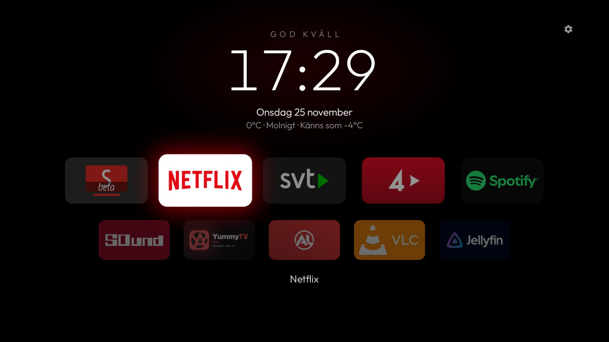
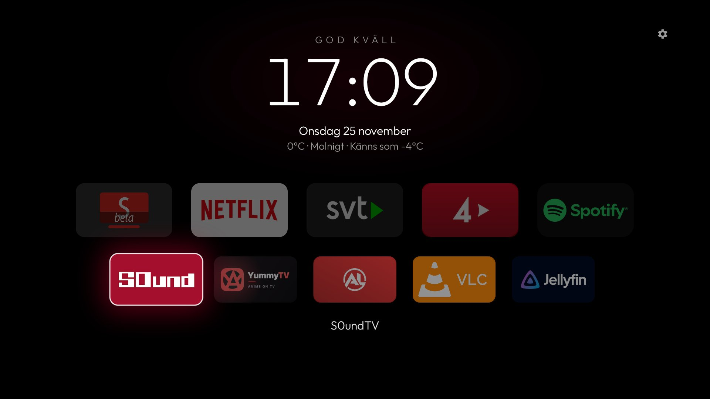
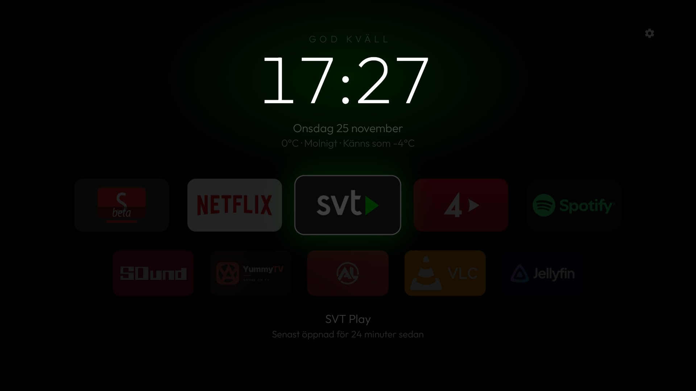
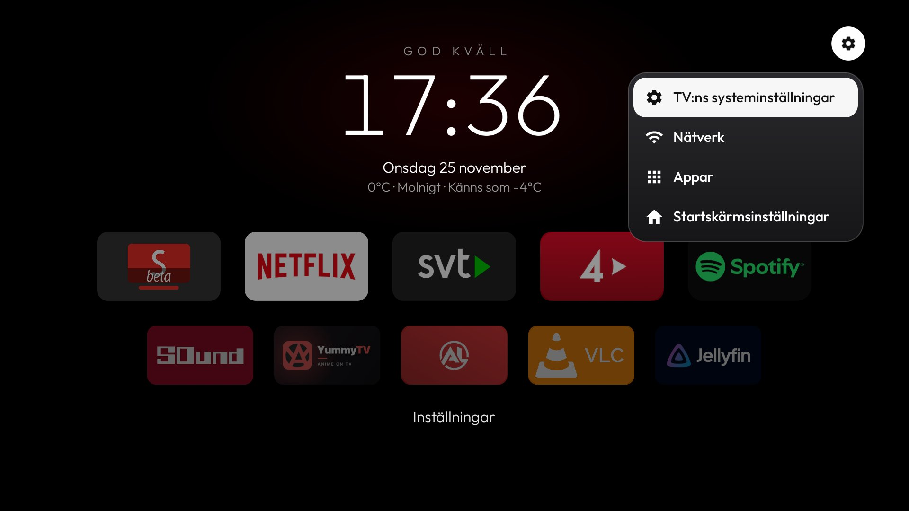
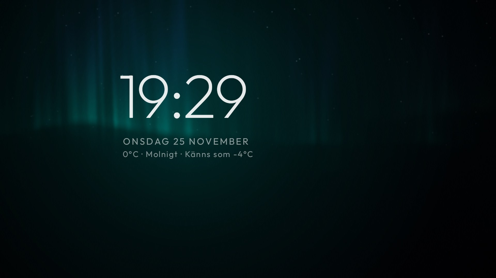

# CleanYourTV, Philips 55OLED934 fork

A personal fork of [CleanYourTV](https://github.com/Gathin23/cleanyourtv), with thanks to upstream. It is tuned for a Philips 55OLED934 (TPM191E, Android TV 11). Licensed MIT, same as upstream: see [LICENSE](LICENSE). The full upstream guide is in [README.upstream.md](README.upstream.md).

## What this fork adds

- A centred "spotlight" Home screen. The focused app steps forward with a glow in the app's colour and the others dim. Row 2 is smaller and dimmed until focus moves there. A "Last opened" line sits under the focused app's name. A faint aura in the app's colour sits behind the clock. OK gives a short press-down feel.
- Rest mode: after 30 s without a key, everything except the clock fades. No frames are drawn while Home rests.
- Weather with a "feels like" temperature, from [Open-Meteo](https://open-meteo.com/), for a configurable latitude/longitude.
- Double Back goes to the clock screensaver, which now has a slow aurora behind the clock (OpenGL ES 2.0, 960x540 at 30 fps, 6 to 10 ms GPU per frame). Its colours follow the screensaver's minute-by-minute colour cycle; TVs whose GPU cannot run it keep the plain glow.
- The screensaver's sky follows the weather and the time of day: the aurora on a clear night, strongest in the middle of it, then snow, rain and fog or overcast as themselves, a warm horizon at dawn and dusk and a dark, cold sky by day. From 23:00 to 06:00 a night mode turns the clock, date and weather warm red and the sky dim.
- OLED pixel shift: Home drifts a few pixels each time it comes back, against burn-in.
- The Options key opens the tile menu.
- A simpler Quick Settings panel: TV settings, Network, Apps, Launcher settings.
- A debloat and speed pass on the TV itself.

| | |
|---|---|
|  |  |
|  |  |

## Measured performance

Centered spotlight Home against the previous Home, over 20 D-pad presses on one TV (the owner's, so treat it as one data point):

- Janky frames: 16.7 % to about 8.5 %.
- GPU p90 frame time: 15 ms to 9 ms.
- PSS: 32 MB to 28 MB.
- Rest mode: no frames drawn.

## Config keys added

All are in `launcher/app/src/main/res/values/config.xml`, and all are on for this TV. A theme can set each one.

- `centered_home`: centred header, rows under it, focused app's name and "Last opened" below.
- `spotlight_focus`: focused tile zooms to 1.12 with a glow in its colour; the rest of its row dims to 55 %.
- `peek_row`: second row drawn smaller and dimmed to 40 % while focus is in the dock.
- `clock_aura`: faint 12 % glow in the focused app's colour behind the clock.
- `press_feedback`: OK presses the tile in for 90 ms before the app opens.
- `clock_aurora`: animated aurora behind the clock screensaver, in the glow's colours.
- `rest_dim_seconds`: seconds without a key before Home fades to 25 %. 30 here, 0 turns it off.

## Build and install

Follow the [upstream guide](README.upstream.md) and [docs/launcher.md](docs/launcher.md): build the launcher and install it with `launcher/build-and-install.sh`, with `TV_HOST=<tv ip>`. Set `latitude` and `longitude` in `config.xml` for your own weather.

## Differences from upstream

- This fork has the `INTERNET` permission, for the weather. Upstream has no network access.
- The APK is over upstream's size limit.
- The design is built for a 1920x1080 OLED.

## Changelog

See [PHILIPS_55OLED934_README.md](PHILIPS_55OLED934_README.md). The TV's own backups, restore scripts and screenshots stay private, so paths such as `backup\restore.bat` in the changelog are not in this repository.
